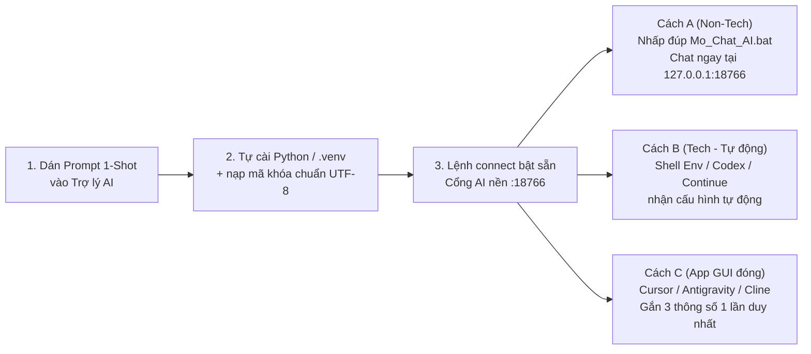

# Hướng Dẫn Trực Quan: Cài Đặt Để Làm Gì & Làm Gì Tiếp Theo?

> **Tóm tắt 1 câu:** Cài công cụ này **1 lần duy nhất** để có sẵn **25+ mô hình AI dùng chung hạn mức công ty**, tự động chuyển dự phòng khi quá tải, và mở ngay được bằng **Web Chat trên trình duyệt (`Mo_Chat_AI`)** hoặc gắn vào các **Trợ lý AI / IDE** (`Codex`, `Continue`, `Cursor`, `Antigravity`, `Cline`).

---

## 1. Công cụ này để làm gì?

| Lợi ích | Không dùng Router | Dùng `llm-provider-router` |
|---|---|---|
| **Số lượng mô hình AI** | Bị kẹt ở 1 tài khoản / 1 mô hình riêng lẻ | Dùng qua **1 đầu mối chung** với nhiều mô hình Chat & Coding |
| **Khi 1 mô hình quá tải / lỗi** | Ngừng việc giữa chừng | Tự động chuyển sang mô hình dự phòng + hồi phục tự động |
| **Dùng cho người Non-Tech** | Không biết cấu hình IDE hay terminal | Có sẵn **trang Web Chat AI tiếng Việt** tại `http://127.0.0.1:18766/` (`Mo_Chat_AI.bat`) |
| **Bảo mật mã khóa** | Dễ lộ khóa trong lịch sử lệnh hoặc chat | Khóa lưu cục bộ (`0600`) và ẩn hoàn toàn khỏi nhật ký |

---

## 2. Sơ đồ hoạt động sau khi dán Prompt 1-Shot

---

## 3. Sau khi cài xong thì làm gì tiếp theo?

### Dành cho người không chuyên kỹ thuật (Non-Tech)
1. **Cách nhanh nhất (dùng ngay lập tức):** Mở thư mục cài đặt (`llm-provider-router` trong thư mục cá nhân) và **nhấp đúp chuột vào `Mo_Chat_AI.bat`** (Windows) hoặc **`Mo_Chat_AI.command`** (macOS/Linux).
2. Trình duyệt sẽ mở trang **Trợ Lý AI Nội Bộ** tại `http://127.0.0.1:18766/`:
   - Tab **1. Chat AI Ngay**: chọn mô hình (`router/auto` hoặc mô hình cụ thể) và hỏi đáp công việc ngay lập tức.
   - Tab **2. Kết nối Trợ lý AI**: có sẵn nút **Sao chép** 3 thông tin để dán vào ứng dụng AI khác nếu cần.
3. **Không cần gõ lại lệnh hay cài lại** ở những lần sau — chỉ cần mở `Mo_Chat_AI`.

### Dành cho đội kỹ thuật (Tech: DEV / DEVOPS / SEC / DATA)

| Công cụ | Trạng thái sau `llm-router connect` | Bạn cần làm gì tiếp? |
|---|---|---|
| **Terminal / Python SDK / OpenAI CLI** | **Tự động kết nối** (`OPENAI_BASE_URL` + `LLM_ROUTER_GATEWAY_URL`) | Mở cửa sổ terminal mới và gọi `http://127.0.0.1:18766/v1` (mã `local-router`, model `router/auto` hoặc `router/coding`) |
| **Codex CLI (`~/.codex/config.toml`)** | **Tự động thêm profile** `[model_providers.llm_router]` | Chọn provider `llm_router` khi chạy Codex |
| **Continue (`~/.continue/config.json`)** | **Tự động thêm model** `LLM Provider Router (Auto)` | Chọn model `LLM Provider Router (Auto)` trong khung chat Continue |
| **Cursor / Antigravity / Cline / ChatBox** | **Ứng dụng GUI đóng** (tôn trọng cài đặt đăng nhập sẵn có, không tự ghi đè) | Mở **Settings → Models / OpenAI-Compatible Provider** → dán 3 giá trị bên dưới → **Save** |

**3 thông số chuẩn để dán vào Cursor / Antigravity / Cline / ChatBox:**
- **Base URL:** `http://127.0.0.1:18766/v1`
- **API Key:** `local-router`
- **Model:** `router/auto` (hoặc `router/coding` khi lập trình)

---

## 4. Làm sao biết hệ thống đã thật sự hoạt động?

1. Mở `http://127.0.0.1:18766/` trên trình duyệt → góc phải hiện chữ xanh **"Đã kết nối — N mô hình AI sẵn sàng"**.
2. Gửi thử 1 câu chào trong tab **Chat AI Ngay** → nhận được câu trả lời kèm tên mô hình và thời gian phản hồi (`ms`).
3. Nếu gặp máy Windows báo lỗi ký tự UTF / BOM khi dán mã khóa hoặc gõ lệnh: phiên bản `v1.1.0+` tự giải mã UTF-8 / UTF-16 BOM, loại bỏ ký tự ẩn (`\ufeff`, `\u200b`, ngoặc kép cong) và bật sẵn `PYTHONUTF8=1` + `chcp 65001` trong cả bộ cài và các file `.bat`.
