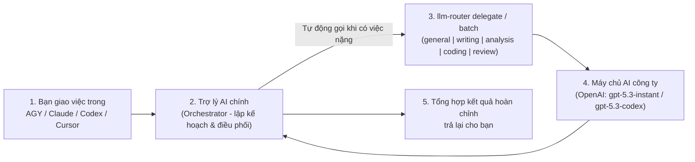

# Hướng Dẫn Trực Quan: Cài Để Làm Gì & Dùng Như Thế Nào Sau Khi Cài?

> **Tóm tắt 1 câu:** Cài công cụ này **1 lần duy nhất** để **Trợ lý AI bạn đang dùng** (**Antigravity, Claude Code, Codex, Cursor**) giữ vai trò **Nhạc trưởng (Orchestrator)** suy nghĩ và điều phối, còn các việc nặng sẽ **tự động giao cho Sub-Agent OpenAI** chạy qua hạn mức chung của công ty.

---

## 1. Cài công cụ này để làm gì?

| Vấn đề trước đây | Sau khi cài `llm-provider-router` |
|---|---|
| Cài xong nhưng Trợ lý AI **vẫn dùng cách cũ** (mọi việc đều tự làm bằng Claude/Gemini/tài khoản riêng) | Lệnh `llm-router connect` **gắn quy tắc & kỹ năng thường trực** để Trợ lý AI tự động gọi `llm-router delegate` / `batch` sang **OpenAI công ty** |
| Phải mở thêm web lạ hoặc tự nhớ lệnh | **Không cần mở phần mềm hay web mới** — tiếp tục chat trong chính Antigravity / Claude / Codex / Cursor |
| Khó biết máy đang dùng mô hình nào hoặc khi nào dùng | Nhạc trưởng (Claude/AGY/Codex) lo lập kế hoạch & đọc file; Sub-Agent OpenAI (`gpt-5.3-instant` / `gpt-5.3-codex`) gánh viết lách, tóm tắt, phân tích, sinh/review code và chạy song song |

---

## 2. Sơ đồ hoạt động: Nhạc trưởng + Sub-Agent OpenAI



---

## 3. Lệnh `llm-router connect` tự động gắn vào đâu?

Khi chạy 1-shot prompt hoặc trình cài đặt, `llm-router connect` tự động phát hiện và cài quy tắc điều phối cho các trợ lý AI đang có trên máy:

| Trợ lý AI | Vị trí tự động cài đặt | Cách kích hoạt sau khi cài |
|---|---|---|
| **Antigravity (AGY)** | `~/.gemini/config/rules/llm-router-subagent.md` (`trigger: always_on`) + `skills/llm-router-subagent/SKILL.md` | **Mở cuộc trò chuyện mới** là tự áp dụng mọi dự án |
| **Claude Code** | `~/.claude/CLAUDE.md` + `agents/openai-worker.md` + `skills/llm-router-subagent/SKILL.md` | **Mở phiên Claude mới**; có sẵn sub-agent `openai-worker` |
| **Codex CLI** | `~/.codex/AGENTS.md` + profile `[model_providers.llm_router]` trong `config.toml` | **Mở phiên Codex mới** là tự đọc quy tắc giao việc |
| **Cursor** | `.cursor/rules/llm-router-subagent.mdc` (`alwaysApply: true`) | **Mở cửa sổ chat Cursor mới** |

> An toàn: Mọi file cấu hình sẵn có đều được sao lưu `.bak` trước khi bổ sung, và hệ thống **tự động bỏ qua** các file quản trị được bảo vệ (`CANARY`).

---

## 4. Sau khi cài xong thì bạn làm gì tiếp theo?

### Bước 1: Mở một cuộc trò chuyện MỚI trong Trợ lý AI quen dùng
- Đóng khung chat cài đặt cũ, bấm **New Chat / Cuộc trò chuyện mới** trong **Antigravity, Claude Code, Codex hoặc Cursor** (để trợ lý nạp quy tắc mới gắn).
- **Không cần** mở thêm trình duyệt hay chạy lại lệnh cài đặt.

### Bước 2: Gõ 1 câu kiểm chứng nhanh (để chắc chắn Sub-Agent OpenAI đang chạy)
Dán câu này vào cuộc trò chuyện mới:

```text
Hãy giao một việc nhỏ cho OpenAI Sub-Agent qua llm-router để xác nhận kết nối đang chạy, rồi báo lại cho tôi tên model OpenAI vừa trả lời.
```

Nếu thấy trợ lý gọi `llm-router delegate` và báo lại tên model (ví dụ `chatgpt/gpt-5.3-instant`), nghĩa là **hệ thống đã chạy tự động 100%**.

### Bước 3: Làm việc như bình thường hằng ngày
- **Người dùng văn phòng (Non-Tech):** Nhờ soạn email, tóm tắt tài liệu, tổng hợp báo cáo, dịch thuật, phân tích phương án → Nhạc trưởng tự gọi sub-agent OpenAI xử lý và trả kết quả tiếng Việt gọn gàng.
- **Đội kỹ thuật (Tech):** Nhờ sinh code, review PR, phân tích log, hoặc xử lý nhiều file song song → Nhạc trưởng điều phối bằng `llm-router delegate --role coding` hoặc `llm-router batch`.

---

## 5. Khắc phục nhanh nếu máy Windows từng báo lỗi UTF / ký tự lạ
- Phiên bản `v1.2.0+` bật sẵn `PYTHONUTF8=1`, `PYTHONIOENCODING=utf-8`, tự giải mã `.env` và stdin theo **UTF-8 / UTF-8 BOM / UTF-16 LE BOM**, đồng thời loại bỏ ký tự ẩn (`\ufeff`, `\u200b`, ngoặc kép cong) khi sao chép mã khóa từ email hoặc chat.
